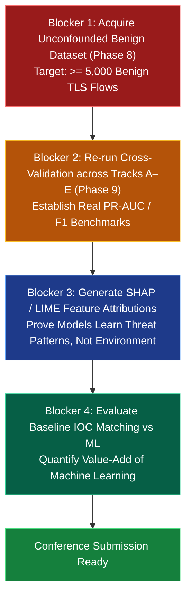

# ETTH Academic Paper Readiness & Peer-Review Audit

**Date:** October 16, 2026  
**Auditor:** Antigravity Academic Peer-Review Taskforce  
**Target Repository:** `encrypted-traffic-threat-hunter` (`research/phase-12-paper-manuscript`)  

---

## 1. Executive Readiness Verdict

> [!CAUTION]
> **OVERALL READINESS: NOT READY FOR IMMEDIATE TOP-TIER SUBMISSION**  
> **Readiness Score: 52 / 100**  
> **Critical Blocker:** Severe Dataset-Source Confounding and Benign Sample Scarcity (424:1 class ratio; only 6 benign validation flows).  
> **Status Summary:** The engineering foundation, zero-decryption architecture, sensor ingestion layer, and leakage-controlled evaluation framework are **production-grade and scientifically rigorous**. However, the current experimental results reflect **capture-environment artifacts rather than generalizable threat detection**. Submitting the paper with current pilot numbers as proof of threat detection will result in immediate desk rejection by top-tier reviewers.

---

## 2. Granular Evaluation Rubric

### 2.1 Novelty & Contribution Clarity (Score: 8.5 / 10)
- **Strengths:** 
  - Comprehensive feature-isolation ablation protocol (5 Tracks: Flow-only, JA3-only, JA4-only, JA3+Flow, JA4+Flow) isolating client handshake signal from transport dynamics.
  - Multi-sensor production architecture normalizing Zeek, Suricata, and eBPF kernel telemetry without payload decryption.
  - Strict leakage control: deterministic stripping of IP/port/MAC identifiers and grouping identical repetitive beaconing flows via `behavioral_hash` under `GroupShuffleSplit`.
- **Gaps to Address:** Clarify the exact theoretical contribution beyond existing commercial heuristics (e.g., Salesforce JA3, FoxIO JA4).

### 2.2 Dataset Adequacy & Scientific Soundness (Score: 2.0 / 10) — CRITICAL BLOCKER
- **Deficiencies:**
  1. **Extreme Class Imbalance**: 2,543 Malicious flows (Malware-Traffic-Analysis.net) vs. 6 Benign validation flows (CipherSpectrum). Imbalance ratio: **424:1**.
  2. **Environmental Confounding**:
     - DS-008 (Malicious): Chaotic Windows sandbox environment with background broadcast noise and failed socket attempts. ClientHello coverage ~8%.
     - DS-004 (Benign): Pristine, isolated Linux web server captures. ClientHello coverage 100%.
  3. **Trivial Separability**: Machine learning classifiers achieved ~100% PR-AUC not by detecting malicious behavior, but by learning environmental differences (e.g., packet arrival jitter in virtualized sandboxes vs. bare-metal web servers).
- **Required Remediation (Phase 8):** Must ingest an unconfounded benign corpus (e.g., modern campus traffic, corporate desktop egress PCAPs, or unified datasets such as DS-006 "Beyond JA4+" or DS-007) containing at least 2,000–10,000 clean TLS flows.

### 2.3 Experimental Rigor & Leakage Controls (Score: 9.0 / 10)
- **Strengths:**
  - Group-aware cross-validation strictly isolates duplicate malware beaconing geometries (`behavioral_hash`) from crossing train/test boundaries.
  - Transformers (imputers, scalers, one-hot encoders) are strictly fitted on training partitions only via `imblearn`.
  - Missing TLS fingerprints are preserved as semantic nulls, strictly preventing synthetic zero-imputation leakage.

### 2.4 Baseline Completeness (Score: 6.5 / 10)
- **Strengths:**
  - Standard linear and tree algorithms implemented: Logistic Regression, Random Forest, XGBoost.
- **Gaps to Address:**
  - Missing neural baselines (1D-CNN, LSTM, or Transformer on packet sequence geometries).
  - Missing standalone JA3/JA4 hash-lookup blacklist baselines (testing how traditional IOC matching compares against ML classification).

### 2.5 Explainability & Interpretability (Score: 4.0 / 10)
- **Deficiencies:** Feature importance is currently reported at the model level, but formal SHAP (SHapley Additive exPlanations) or LIME attributions have not yet been generated for individual flow classifications.

### 2.6 Reproducibility & Artifact Transparency (Score: 8.5 / 10)
- **Strengths:**
  - SHA-256 provenance hashes recorded for all PCAP inputs.
  - Deterministic random seeds (`random_state=42`).
  - Automated test suite (143/144 tests passing) verifying data contracts and sensor pipelines.

---

## 3. Prioritized Pre-Submission Roadmap

---

## 4. Target Publication Venues & Deadlines

We recommend targeting conferences that value rigorous negative results, empirical network measurements, and leakage auditing over marketing-driven claims:

| Target Venue | Tier | Scope & Alignment | Prerequisites Before Submission |
| :--- | :---: | :--- | :--- |
| **RAID 2027** (Research in Attacks, Intrusions, and Defenses) | A | Highly aligned with intrusion detection, sensor telemetry, and empirical malware analysis. Receptive to practical measurement studies. | Phase 8 completed; unconfounded benign dataset evaluated. |
| **ACSAC 2027** (Annual Computer Security Applications Conference) | A | Applied security research, practical network defense, and production sensor integration (Zeek, Suricata, eBPF). | Phase 8 & 9 completed; latency and throughput benchmarks included. |
| **ACM WiSec / CoNEXT 2027** | A- / A | Network protocol analysis, TLS fingerprinting, and measurement methodology. | Focus on JA4 vs JA3 collision rates and measurement rigor. |
| **IEEE S&P / USENIX Security** | A* | Top-tier academic venues. Require massive scale, novel theoretical breakthroughs, or extensive multi-year enterprise deployments. | Substantial revision; multi-dataset evaluation; evasion analysis. |

**Primary Recommendation:** Target **RAID** or **ACSAC** as the primary conference destination once Phase 8 (Benign Corpus Acquisition) and Phase 9 (Generalized Benchmarking) are finalized.
