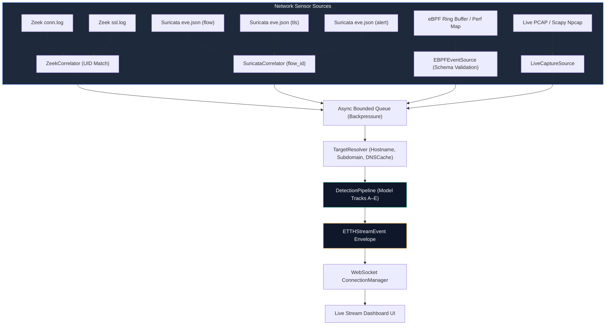

# Phase 11 — Sensor Ingestion & Telemetry Architecture

## 1. Overview & Objective

The **Encrypted Traffic Threat Hunter (ETTH)** Sensor Ingestion Layer extends the platform from offline PCAP replay and Scapy-based interface sniffing to production-grade network telemetry from:
- **Zeek** (formerly Bro) network security monitor
- **Suricata** high-performance Network Threat Detection engine
- **eBPF** (extended Berkeley Packet Filter) Linux socket/flow observability

### The Zero-Decryption Boundary
Across all sensor ingest pipelines, ETTH maintains its fundamental scientific commitment:
1. **Zero Payload Decryption**: Network packet payloads are never decrypted or inspected in plaintext.
2. **Zero Fingerprint Fabrication**: Missing TLS handshakes, JA3, or JA4 hashes are preserved as semantic nulls (`None`). No dummy values are imputed.
3. **Canonical Event Contract**: Normalized sensor flows feed seamlessly into `DetectionPipeline.process_flow()`, producing validated `ETTHStreamEvent` messages for real-time inference and WebSocket streaming.

---

## 2. Sensor Integration Architecture

---

## 3. Sensor Normalization Matrix

| Feature / Metadata | Zeek (`conn.log` + `ssl.log`) | Suricata (`eve.json`) | eBPF Kernel Telemetry |
| :--- | :--- | :--- | :--- |
| **Connection ID** | `uid` (string) | `flow_id` (numeric/string) | `flow_id` derived from 5-tuple + PID |
| **5-Tuple** | `id.orig_h`, `id.orig_p`, `id.resp_h`, `id.resp_p`, `proto` | `src_ip`, `src_port`, `dest_ip`, `dest_port`, `proto` | `saddr`, `sport`, `daddr`, `dport`, `protocol` |
| **Duration** | `duration` (seconds) | `flow.age` (seconds) | `duration_ns` / `end_ns - start_ns` (nanoseconds to seconds) |
| **Packet Counts** | `orig_pkts`, `resp_pkts` | `flow.pkts_toserver`, `flow.pkts_toclient` | `packets_sent`, `packets_recv` |
| **Byte Counts** | `orig_bytes`, `resp_bytes` | `flow.bytes_toserver`, `flow.bytes_toclient` | `bytes_sent`, `bytes_recv` |
| **TLS Version** | `ssl.version` | `tls.version` | `tls_version` (if kprobe attached) |
| **Server Name (SNI)** | `ssl.server_name` | `tls.sni` | `tls_sni` (ClientHello socket probe) |
| **JA3 Fingerprint** | `ssl.ja3` (Zeek JA3 package) | `tls.ja3.hash` | `ja3_hash` (collector probe) |
| **JA4 Fingerprint** | `ssl.ja4` (Zeek JA4 package) | `tls.ja4` (Suricata 7+) | `ja4` (collector probe) |
| **Alert / Threat Metadata** | N/A (or Notice framework) | `alert.signature`, `alert.severity` | `process_name`, `process_pid` |

---

## 4. Reliability & Error Isolation

- **Backpressure**: Ingestion adapters push to an `asyncio.Queue(maxsize=5000)`. If the detection pipeline or WebSocket downstream slows, sensors drop or throttle incoming lines rather than causing unbounded heap growth.
- **Correlator TTL**: State machines maintain an in-memory sliding window (default: 60s TTL) to match asynchronous events across logs. Stale entries are evicted automatically.
- **Malformed Line Isolation**: Corrupted JSON lines or truncated logs increment `malformed_lines` without crashing the ingestion worker or stream loops.
- **Out-of-Order Tolerance**: Correlators accept `ssl` or `alert` records arriving before the corresponding `conn` or `flow` event without dropping state.
